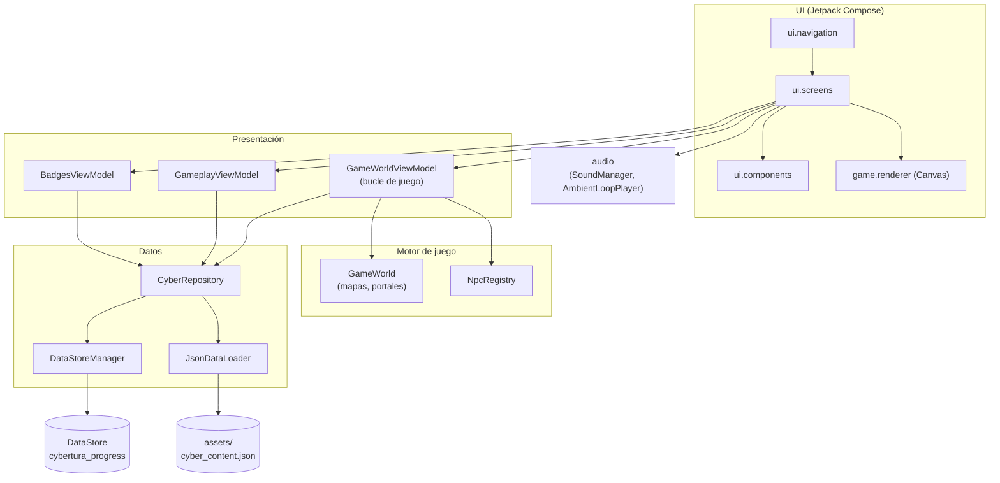
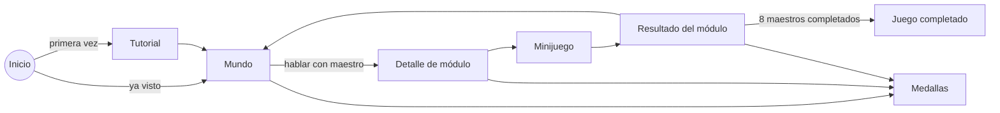

# CyberTura — Una aventura de ciberseguridad

Juego móvil educativo para Android que enseña conceptos básicos de **ciudadanía y seguridad digital** a niños de **11 a 12 años**. El jugador recorre una ciudad 2D en vista cenital, habla con ocho maestros y supera un minijuego por cada tema: contraseñas, phishing, privacidad, ciberacoso, redes sociales, dispositivos del hogar, malware y juegos en línea.

> Prototipo desarrollado como Proyecto de Grado de Ingeniería de Sistemas. Nivel de madurez objetivo: **TRL 4**, un prototipo funcional validado en un entorno controlado.

---

## Contenido

- [Características](#características)
- [Módulos educativos](#módulos-educativos)
- [Stack tecnológico](#stack-tecnológico)
- [Arquitectura](#arquitectura)
- [Estructura del proyecto](#estructura-del-proyecto)
- [Requisitos](#requisitos)
- [Compilar y ejecutar](#compilar-y-ejecutar)
- [Pruebas](#pruebas)
- [Editar el contenido educativo](#editar-el-contenido-educativo)
- [Privacidad](#privacidad)
- [Documentación adicional](#documentación-adicional)
- [Autoría y créditos](#autoría-y-créditos)

---

## Características

- **Mundo 2D explorable**: mapa exterior de 50×50 tiles con interiores de casas y portales, renderizado con un motor propio sobre `Canvas` de Jetpack Compose.
- **Ocho maestros (NPC)** que entregan las misiones en un orden fijo. Una guía de objetivo (banner, brújula y flecha en la puerta) indica a dónde ir.
- **Un minijuego por módulo**: forja de contraseñas, clasificación con deslizamiento, historias de chat, búsqueda de pistas y defensa arcade.
- **Gamificación**: XP, niveles con rangos, medallas por módulo y una pantalla final al completar la aventura.
- **Retroalimentación inmediata** que no castiga el error: el niño puede reintentar sin perder progreso.
- **Audio**: música ambiente en bucle y efectos de pasos, entrada a casas, chat, acierto, error y módulo completado.
- **Tutorial** en la primera ejecución.
- **Funciona 100 % sin conexión**. No tiene cuentas, no usa red y no recoge datos personales.

## Módulos educativos

El contenido vive en [`app/src/main/assets/cyber_content.json`](app/src/main/assets/cyber_content.json).

Los módulos se juegan en el orden de misiones definido en `NpcRegistry` (`game/engine/NpcData.kt`):

| # | Módulo | Tema | Minijuego |
|---|---|---|---|
| 1 | Comunidad y Respeto Digital | Ciberacoso | `CHAT_STORY`: el chat del grupo |
| 2 | Guardianes de la Contraseña | Contraseñas seguras | `FORGE_KEY`: forjar una llave fuerte |
| 3 | Hogar Conectado y Seguro | Wi-Fi y dispositivos | `CHAT_STORY`: el chat de la familia |
| 4 | Bosque Libre de Virus | Malware | `TAP_DEFENSE`: defiende el bosque |
| 5 | Escudo de Privacidad | Datos personales | `SWIPE_SORT`: ¿lo comparto o lo guardo? |
| 6 | Cazadores de Trampas | Phishing | `SWIPE_SORT`: ¿seguro o trampa? |
| 7 | Jugadores Inteligentes | Juegos en línea | `SPOT_THE_CLUES`: detective del chat del juego |
| 8 | Huella Digital Responsable | Redes sociales | `SPOT_THE_CLUES`: detective de publicaciones |

## Stack tecnológico

| Tecnología | Versión | Uso |
|---|---|---|
| Kotlin | 2.2.10 | Único lenguaje del proyecto |
| Android Gradle Plugin | 9.4.1 | Compilación |
| Jetpack Compose (BOM) | 2026.02.01 | Interfaz declarativa y `Canvas` del juego |
| Material 3 | por BOM | Tema y componentes |
| Navigation Compose | 2.8.8 | Navegación entre pantallas |
| Lifecycle ViewModel Compose | 2.8.7 | ViewModels con `StateFlow` |
| DataStore Preferences | 1.1.2 | Guardado del progreso |
| Gson | 2.11.0 | Lectura del JSON de contenido |
| Kotlin Coroutines / Flow | — | Bucle de juego y estado reactivo |
| JUnit 4 | 4.13.2 | Pruebas unitarias |

`minSdk 24` (Android 7.0) · `targetSdk 37` · `compileSdk 37` · Java 11

## Arquitectura

La app es un solo módulo (`:app`) con **MVVM** y **flujo de datos unidireccional (UDF)**: cada pantalla observa un `StateFlow` de su ViewModel y le envía eventos mediante lambdas. Las dependencias se inyectan a mano desde `CyberturaApplication`.



### Navegación



## Estructura del proyecto

```text
cybertura/
├── build.gradle.kts
├── settings.gradle.kts
├── gradle/libs.versions.toml           # catálogo de versiones
└── app/
    ├── build.gradle.kts
    ├── docs/                           # documentación técnica y de diseño
    └── src/
        ├── main/
        │   ├── assets/cyber_content.json
        │   ├── java/com/example/cybertura/
        │   │   ├── CyberturaApplication.kt   # inyección manual de dependencias
        │   │   ├── MainActivity.kt
        │   │   ├── audio/        SoundManager, AmbientLoopPlayer
        │   │   ├── data/
        │   │   │   ├── local/       DataStoreManager, JsonDataLoader
        │   │   │   ├── model/       ContentModels, UserProgress
        │   │   │   └── repository/  CyberRepository
        │   │   ├── game/
        │   │   │   ├── engine/      GameWorld, GameState, NpcData, KeyStrength
        │   │   │   └── renderer/    WorldRenderer, SpriteRenderer
        │   │   └── ui/
        │   │       ├── components/  CyberComponents
        │   │       ├── navigation/  Screen, CyberturaNavHost
        │   │       ├── screens/     mundo, tutorial, minijuegos, resultados, medallas
        │   │       ├── theme/       Color, Type, Theme
        │   │       └── viewmodel/   GameWorld, Gameplay, Badges
        │   └── res/
        │       ├── drawable/     sprites de personajes y tiles (PNG)
        │       └── raw/          música y efectos de sonido (MP3)
        ├── test/                 pruebas unitarias
        └── androidTest/          pruebas instrumentadas
```

## Requisitos

- **Android Studio** compatible con AGP 9.4.1 y Kotlin 2.2.10
- **JDK 11 o superior** (el plugin *foojay* descarga el toolchain si hace falta)
- **Android SDK 37**
- Un dispositivo o emulador con **Android 7.0 (API 24)** o superior

## Compilar y ejecutar

```bash
git clone https://github.com/byckyka/cybertura.git
cd cybertura
```

**Desde Android Studio:** *File → Open*, selecciona la carpeta `cybertura`, espera la sincronización de Gradle y ejecuta la configuración `app`. Android Studio crea `local.properties` con la ruta del SDK.

**Desde la terminal:**

```powershell
# Windows
.\gradlew.bat assembleDebug     # genera app/build/outputs/apk/debug/app-debug.apk
.\gradlew.bat installDebug      # instala en el dispositivo o emulador conectado
```

```bash
# macOS / Linux
./gradlew assembleDebug
./gradlew installDebug
```

No hace falta configurar variables de entorno, claves ni servicios externos.

## Pruebas

```powershell
.\gradlew.bat test                   # pruebas unitarias (JVM)
.\gradlew.bat connectedAndroidTest   # pruebas instrumentadas (requiere dispositivo)
```

Las pruebas unitarias de `ContentAndProgressUnitTest` cubren el cálculo de progreso, nivel, XP y rango en `UserProgress`.

## Editar el contenido educativo

Los textos, preguntas y minijuegos no están escritos en el código: se leen de `app/src/main/assets/cyber_content.json`. Así, docentes y expertos pueden ajustar el contenido sin tocar Kotlin. Cada módulo tiene:

- `id`, `title` y metadatos del módulo
- `challenges`: lista de retos, cada uno con un `type` (`FORGE_KEY`, `SWIPE_SORT`, `CHAT_STORY`, `SPOT_THE_CLUES` o `TAP_DEFENSE`) y los datos de ese minijuego

Después de editar el JSON, vuelve a compilar la app para ver los cambios.

> Los nombres de los recursos en `res/drawable` y `res/raw` solo pueden tener minúsculas, dígitos y `_`. Cualquier otro carácter rompe la compilación.

## Privacidad

CyberTura está pensada para menores de edad:

- No pide el permiso `INTERNET` ni ningún otro.
- No tiene cuentas, analítica ni SDK de terceros.
- Solo guarda el progreso del juego en el propio dispositivo, con DataStore.

## Documentación adicional

- [`app/docs/DOCUMENTACION_TECNICA.md`](app/docs/DOCUMENTACION_TECNICA.md): auditoría técnica completa (arquitectura, persistencia, seguridad, pruebas y trabajo futuro). Es del 6 de octubre de 2026, así que no incluye el octavo módulo, los minijuegos ni el audio que se agregaron después.
- [`app/docs/CAPITULO_DISENO_ARQUITECTURA.md`](app/docs/CAPITULO_DISENO_ARQUITECTURA.md): capítulo de diseño de ingeniería, con la justificación de pasar de Unity a Kotlin nativo.

## Autoría y créditos

Desarrollado por **Santiago Matajira Rueda** ([@byckyka](https://github.com/byckyka)) como Trabajo de Grado para optar al título de Ingeniero de Sistemas.

| Rol | Nombre |
|---|---|
| Director | Javier Pinzón |
| Asesores | Yamid Gamba, Daniel Cabrera, Leonardo Talero, Leonardo Pardo |
| Institución | Universidad Autónoma de Bucaramanga, Facultad de Ingeniería, Ingeniería de Sistemas |

### Recursos de terceros

Los sprites, los tiles del mapa, la música y los efectos de sonido (`res/drawable/*.png` y `res/raw/*.mp3`) provienen de [Pixabay](https://pixabay.com) y se usan bajo la [Licencia de contenido de Pixabay](https://pixabay.com/service/license-summary/). Esa licencia permite el uso gratuito sin atribución obligatoria; aun así se reconoce aquí y en la pantalla de créditos del juego. Los derechos de estos recursos pertenecen a sus autores.

El ícono de la app (`res/mipmap-*/ic_launcher*.png`) se generó con inteligencia artificial (ChatGPT, de OpenAI) y se adaptó como ícono adaptativo de Android.

© 2026 Santiago Matajira Rueda. Todos los derechos reservados sobre el código y el contenido educativo; no incluye los recursos de terceros listados arriba. Este repositorio es público para consulta académica. Para usar, copiar o redistribuir el código o el contenido hace falta autorización del autor.
