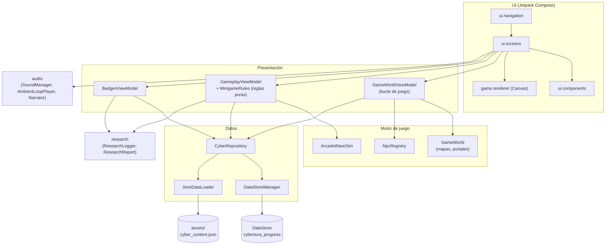

# CyberTura — Una aventura de ciberseguridad

Juego móvil educativo para Android que enseña conceptos básicos de **ciudadanía y seguridad digital** a niños de **11 a 12 años**. El jugador recorre una ciudad 2D en vista cenital y habla con ocho maestros. Cada uno le da una mini lección, un minijuego y una pregunta de situación real sobre su tema: contraseñas, phishing, privacidad, ciberacoso, redes sociales, dispositivos del hogar, malware y juegos en línea.

> Prototipo desarrollado como Proyecto de Grado de Ingeniería de Sistemas. Nivel de madurez objetivo: **TRL 4**, un prototipo funcional validado en un entorno controlado.

---

## Contenido

- [Características](#características)
- [Módulos educativos](#módulos-educativos)
- [Stack tecnológico](#stack-tecnológico)
- [Arquitectura](#arquitectura)
- [Estructura del proyecto](#estructura-del-proyecto)
- [Requisitos](#requisitos)
- [Compilar y ejecutar](#compilar-y-ejecutar)
- [Pruebas](#pruebas)
- [Editar el contenido educativo](#editar-el-contenido-educativo)
- [Modo investigador](#modo-investigador)
- [Privacidad](#privacidad)
- [Documentación adicional](#documentación-adicional)
- [Autoría y créditos](#autoría-y-créditos)

---

## Características

- **Mundo 2D explorable**: mapa exterior de 50×50 tiles con interiores de casas y portales, renderizado con un motor propio sobre `Canvas` de Jetpack Compose.
- **Ocho maestros (NPC)** que entregan las misiones en un orden fijo. Una guía de objetivo (banner, brújula y flecha en la puerta) indica a dónde ir.
- **Cada módulo sigue la secuencia aprender → practicar → aplicar**: una mini lección de tres tarjetas, un minijuego (forja de contraseñas, clasificación con deslizamiento, historias de chat, búsqueda de pistas o defensa arcade) y una pregunta de situación real.
- **Gamificación**: XP, niveles con rangos, medallas por módulo, estrellas (1 a 3) por minijuego con mejor marca guardada y una pantalla final al completar la aventura.
- **Perfil del jugador**: al terminar el tutorial elige un alias y su personaje.
- **Retroalimentación inmediata** que no castiga el error: el niño puede reintentar sin perder progreso, y repasar cualquier módulo ya superado hablando otra vez con su maestro.
- **Narración opcional**: un botón lee en voz alta las lecciones, los diálogos y los enunciados con la voz del propio teléfono (si tiene una en español).
- **Audio**: música ambiente en bucle y efectos de pasos, entrada a casas, chat, acierto, error y módulo completado.
- **Tutorial** en la primera ejecución.
- **Modo investigador** oculto para la prueba piloto: registra cada intento de cada reto, aplica un cuestionario de conocimientos antes y después de jugar y una encuesta de percepción, y exporta todo en un CSV.
- **Funciona 100 % sin conexión**. No tiene cuentas, no usa red y no recoge datos personales.

## Módulos educativos

El contenido vive en [`app/src/main/assets/cyber_content.json`](app/src/main/assets/cyber_content.json).

Los módulos se juegan en el orden de misiones definido en `NpcRegistry` (`game/engine/NpcData.kt`):

Cada módulo tiene, además del minijuego de la tabla, una lección previa y una pregunta final de opción múltiple (`MULTIPLE_CHOICE`). La pregunta vale 50 XP de los puntos del módulo; el total de la aventura es 2500 XP.

| # | Módulo | Tema | Minijuego |
|---|---|---|---|
| 1 | Comunidad y Respeto Digital | Ciberacoso | `CHAT_STORY`: el chat del grupo |
| 2 | Escudo de Privacidad | Datos personales | `SWIPE_SORT`: ¿lo comparto o lo guardo? |
| 3 | Guardianes de la Contraseña | Contraseñas seguras | `FORGE_KEY`: forjar una llave fuerte |
| 4 | Jugadores Inteligentes | Juegos en línea | `SPOT_THE_CLUES`: detective del chat del juego |
| 5 | Hogar Conectado y Seguro | Wi-Fi y dispositivos | `CHAT_STORY`: el chat de la familia |
| 6 | Bosque Libre de Virus | Malware | `TAP_DEFENSE`: defiende el bosque |
| 7 | Cazadores de Trampas | Phishing | `SWIPE_SORT`: ¿seguro o trampa? |
| 8 | Huella Digital Responsable | Redes sociales | `SPOT_THE_CLUES`: detective de publicaciones |

## Stack tecnológico

| Tecnología | Versión | Uso |
|---|---|---|
| Kotlin | 2.2.10 | Único lenguaje del proyecto |
| Android Gradle Plugin | 9.4.1 | Compilación |
| Jetpack Compose (BOM) | 2026.02.01 | Interfaz declarativa y `Canvas` del juego |
| Material 3 | por BOM | Tema y componentes |
| Navigation Compose | 2.8.8 | Navegación entre pantallas |
| Lifecycle ViewModel Compose | 2.8.7 | ViewModels con `StateFlow` |
| DataStore Preferences | 1.1.2 | Guardado del progreso |
| Gson | 2.11.0 | Lectura del JSON de contenido |
| Kotlin Coroutines / Flow | — | Bucle de juego y estado reactivo |
| JUnit 4 | 4.13.2 | Pruebas unitarias |

`minSdk 24` (Android 7.0) · `targetSdk 37` · `compileSdk 37` · Java 11

## Arquitectura

La app es un solo módulo (`:app`) con **MVVM** y **flujo de datos unidireccional (UDF)**: cada pantalla observa un `StateFlow` de su ViewModel y le envía eventos mediante lambdas. Las dependencias se inyectan a mano desde `CyberturaApplication`.



### Navegación

```mermaid
flowchart LR
    START((Inicio)) -->|primera vez| TUT[Tutorial]
    START -->|ya visto| HOME[Mundo]
    TUT --> PF[Alias y personaje]
    PF --> HOME
    PF -->|sesión de piloto abierta| KT1[Cuestionario inicial] --> HOME
    HOME -->|hablar con maestro| MD[Detalle de módulo]
    MD --> LS[Mini lección]
    LS --> GP[Minijuego]
    GP --> Q[Pregunta de situación real]
    Q --> MR[Resultado del módulo]
    MR --> HOME
    MR -->|8 maestros completados| GC[Juego completado]
    GC -->|sesión de piloto abierta| KT2[Cuestionario final] --> SV[Encuesta]
    HOME & MD & MR --> BD[Medallas]
```



## Estructura del proyecto

```text
cybertura/
├── build.gradle.kts
├── settings.gradle.kts
├── gradle/libs.versions.toml           # catálogo de versiones
└── app/
    ├── build.gradle.kts
    ├── docs/                           # documentación técnica y de diseño
    └── src/
        ├── main/
        │   ├── assets/cyber_content.json
        │   ├── java/io/github/byckyka/cybertura/
        │   │   ├── CyberturaApplication.kt   # inyección manual de dependencias
        │   │   ├── MainActivity.kt
        │   │   ├── audio/        SoundManager, AmbientLoopPlayer, SeamlessLoop, Narrator
        │   │   ├── data/
        │   │   │   ├── local/       DataStoreManager, JsonDataLoader
        │   │   │   ├── model/       ContentModels, UserProgress
        │   │   │   └── repository/  CyberRepository
        │   │   ├── game/
        │   │   │   ├── engine/      GameWorld, GameState, NpcData, KeyStrength, ArcadeWaveSim, PlayerCharacters
        │   │   │   └── renderer/    WorldRenderer, SpriteRenderer, GameSprites
        │   │   ├── research/     ResearchLogger, ResearchReport, ResearchSurvey, KnowledgeTest, ForegroundClock
        │   │   └── ui/
        │   │       ├── components/  CyberComponents, Narration, Reveal
        │   │       ├── navigation/  Screen, CyberturaNavHost
        │   │       ├── screens/     mundo, tutorial, perfil, lección, minijuegos, resultados, medallas, cuestionario, encuesta
        │   │       ├── theme/       Color, Type, Theme
        │   │       └── viewmodel/   GameWorld, Gameplay, Badges, MinigameStates, MinigameRules
        │   └── res/
        │       ├── drawable/     sprites de personajes y tiles (PNG)
        │       └── raw/          música y efectos de sonido (MP3)
        └── test/                 pruebas unitarias
```

## Requisitos

- **Android Studio** compatible con AGP 9.4.1 y Kotlin 2.2.10 (se recomienda la versión estable más reciente).
- **Android SDK 37**. Android Studio ofrece instalarlo al sincronizar si falta.
- **Java**: Gradle se ejecuta con **JDK 25** (`gradle/gradle-daemon-jvm.properties`) y lo descarga solo la primera vez. El código se compila con nivel Java 11. Desde Android Studio no hay que instalar nada aparte.
- **Conexión a internet en la primera compilación**, para descargar Gradle 9.6, el JDK y las librerías. Después compila sin conexión.
- Un dispositivo o emulador con **Android 7.0 (API 24)** o superior.

## Compilar y ejecutar

```bash
git clone https://github.com/byckyka/cybertura.git
cd cybertura
```

**Desde Android Studio:** *File → Open*, selecciona la carpeta `cybertura`, espera la sincronización de Gradle y ejecuta la configuración `app`. Android Studio crea `local.properties` con la ruta del SDK.

**Desde la terminal:**

```powershell
# Windows
.\gradlew.bat assembleDebug     # genera app/build/outputs/apk/debug/app-debug.apk
.\gradlew.bat installDebug      # instala en el dispositivo o emulador conectado
```

```bash
# macOS / Linux
./gradlew assembleDebug
./gradlew installDebug
```

### Versión release (optimizada)

```powershell
.\gradlew.bat assembleRelease   # genera app/build/outputs/apk/release/app-release.apk (~5,5 MB)
.\gradlew.bat installRelease
```

La versión release se reduce y optimiza con R8 (`proguard-rules.pro` conserva las clases de `data.model` que lee Gson). Como la app no se publica en tiendas, se firma con la **clave debug** que Android Studio genera en cada PC; por eso compila en cualquier equipo sin configurar nada. Si se instala una versión firmada en otro PC sobre una ya instalada, Android pide desinstalar primero, y eso borra el progreso y los datos del piloto: **exporta el CSV antes**.

En Android Studio se cambia entre debug y release en *Build → Select Build Variant*.

No hace falta configurar variables de entorno, claves ni servicios externos.

## Pruebas

```powershell
.\gradlew.bat test                   # pruebas unitarias (JVM)
```

Hay 117 pruebas unitarias, todas en la JVM (no necesitan teléfono):

| Archivo | Pruebas | Qué cubre |
|---|---:|---|
| `ContentValidationTest` | 15 | `cyber_content.json` y el mapa: 8 módulos y 2500 XP, lección y pregunta en cada módulo, una sola respuesta correcta, minijuegos ganables, portales y maestros alcanzables |
| `MinigameRulesTest` | 25 | Reglas de los cinco minijuegos y de la pregunta: aciertos, errores, bloqueos y final |
| `ArcadeWaveSimTest` | 13 | Simulación de una oleada del arcade |
| `ResearchReportTest` | 14 | Datos del piloto: tiempo sin contar el segundo plano y armado del CSV |
| `KnowledgeTestTest` | 9 | Cuestionario de conocimientos: puntaje, «No lo sé» y filas de antes y después |
| `ResearchSurveyTest` | 7 | Encuesta: nada marcado por defecto y lo no respondido sale vacío |
| `ProfileAndNarrationTest` | 9 | Reglas del alias y texto que se le pasa a la voz |
| `ProgressStoreTest` | 8 | Progreso guardado: puntos, medalla, mejor marca de estrellas y reinicio |
| `NpcDialogTest` | 7 | Qué ofrece cada maestro: aceptar, repasar o indicar a dónde ir |
| `SeamlessLoopTest` | 6 | Bucle de la música sin cortes |
| `ContentAndProgressUnitTest` | 4 | Progreso, nivel, XP y rango en `UserProgress` |

Si alguien edita el JSON y comete un error, `test` falla y dice qué módulo y qué dato revisar.

## Editar el contenido educativo

Los textos, preguntas y minijuegos no están escritos en el código: se leen de `app/src/main/assets/cyber_content.json`. Así, docentes y expertos pueden ajustar el contenido sin tocar Kotlin. Cada módulo tiene:

- `id`, `title` y metadatos del módulo
- `lesson`: la mini lección, de 2 a 4 tarjetas con `emoji`, `title` y `text` (máximo 240 caracteres por tarjeta)
- `challenges`: dos retos. El primero es el minijuego, con un `type` (`FORGE_KEY`, `SWIPE_SORT`, `CHAT_STORY`, `SPOT_THE_CLUES` o `TAP_DEFENSE`) y sus datos. El segundo es la pregunta de situación real (`MULTIPLE_CHOICE`), con al menos tres `options` y exactamente una correcta; cada opción lleva su explicación

Después de editar el JSON, ejecuta `.\gradlew.bat test` para validarlo y vuelve a compilar la app para ver los cambios.

> Los nombres de los recursos en `res/drawable` y `res/raw` solo pueden tener minúsculas, dígitos y `_`. Cualquier otro carácter rompe la compilación.

## Modo investigador

Herramienta oculta para la prueba piloto; los niños no la ven.

1. En la pantalla de medallas, toca **5 veces seguidas** el título *Sala de trofeos*.
2. Escribe el PIN **2026**.
3. En *Nueva sesión*, escribe un **código de participante** (por ejemplo `P01`), nunca el nombre del niño, y pulsa *Iniciar sesión*. La aventura se reinicia desde el tutorial para que cada participante empiece de cero.
4. Tras crear su perfil, el niño responde el **cuestionario de conocimientos** (8 preguntas, una por módulo, con la opción «No lo sé»; no muestra si acertó). Mientras la sesión está activa se registra cada intento de cada reto. Cuando completa la aventura responde el mismo cuestionario otra vez y después la **encuesta de percepción** (los 7 ítems de satisfacción del instrumento del proyecto, con escala de caritas y ninguna marcada de antemano); si no alcanzó a terminar, abre ambos desde el panel con *Abrir cuestionario final* y *Abrir encuesta del participante*. Al terminar, pulsa *Terminar sesión*.
5. En *Exportar resultados*, elige **Guardar en carpeta** o **Compartir** (Drive, correo…). Se genera un solo archivo, `cybertura_resultados_<fecha>.csv`, que abre directo en Excel.

El CSV tiene una fila por participante y reto (dos por módulo: el minijuego y la pregunta), con estas columnas: Participante, Fecha, Módulo, Jefe, Tema, Reto, Resultado, Intentos, Tiempo, Tiempo (segundos), Aciertos, Errores, Ayudas, Estrellas y XP ganada. En la pregunta, *Errores* son las opciones equivocadas elegidas antes de acertar (0 = acertó a la primera). *Tiempo* no cuenta los ratos con la app en segundo plano. *Ayudas* solo aplica al minijuego de detective (`SPOT_THE_CLUES`). Después vienen el cuestionario de conocimientos (una fila por participante y momento, con los aciertos y cada pregunta como 1, 0, NS o vacío) y las respuestas de la encuesta (columnas P1 a P7; vacío = no respondió) y, al final, una guía que explica cada columna.

*Borrar todos los datos del piloto* elimina las sesiones del teléfono, así que conviene exportarlas antes.

## Privacidad

CyberTura está pensada para menores de edad:

- No pide el permiso `INTERNET` ni ningún otro.
- No tiene cuentas, analítica ni SDK de terceros.
- Guarda el progreso del juego en el propio dispositivo, con DataStore.
- El alias del jugador es una sola palabra de hasta 12 letras o números (no cabe un nombre completo, un correo ni un teléfono), se queda en el teléfono y no aparece en el CSV del piloto.
- La narración usa la voz instalada en el teléfono; no envía el texto a ningún servicio.
- La encuesta no tiene preguntas de texto libre.
- El modo investigador guarda los intentos **solo en el teléfono**, identificados con un código (`P01`), sin nombres, ubicación ni identificadores del dispositivo. Nada sale del teléfono salvo que el investigador exporte el CSV.
- Los CSV del piloto y los consentimientos firmados **no deben subirse a este repositorio**, porque es público.

## Documentación adicional

- [`app/docs/DOCUMENTACION_TECNICA.md`](app/docs/DOCUMENTACION_TECNICA.md): auditoría técnica completa (arquitectura, persistencia, seguridad, pruebas y trabajo futuro). Su cuerpo es del 6 de octubre de 2026; la sección inicial «Actualización de noviembre de 2026» resume lo que cambió desde entonces.
- [`app/docs/CAPITULO_DISENO_ARQUITECTURA.md`](app/docs/CAPITULO_DISENO_ARQUITECTURA.md): capítulo de diseño de ingeniería, con la justificación de pasar de Unity a Kotlin nativo.
- El documento final del proyecto de grado se entrega por separado a la universidad y no está en este repositorio.

## Autoría y créditos

Desarrollado por **Santiago Matajira Rueda** ([@byckyka](https://github.com/byckyka)) como Trabajo de Grado para optar al título de Ingeniero de Sistemas.

| Rol | Nombre |
|---|---|
| Director | Javier Pinzón |
| Asesores | Yamid Gamba, Daniel Cabrera, Leonardo Talero, Leonardo Pardo |
| Institución | Universidad Autónoma de Bucaramanga, Facultad de Ingeniería, Ingeniería de Sistemas |

### Recursos de terceros

Los sprites, los tiles del mapa, la música y los efectos de sonido (`res/drawable/*.png` y `res/raw/*.mp3`) provienen de [Pixabay](https://pixabay.com) y se usan bajo la [Licencia de contenido de Pixabay](https://pixabay.com/service/license-summary/). Esa licencia permite el uso gratuito sin atribución obligatoria; aun así se reconoce aquí y en la pantalla de créditos del juego. El tileset del agua es de [Pipoya](https://pipoya.net). Los derechos de estos recursos pertenecen a sus autores.

El ícono de la app (`res/mipmap-*/ic_launcher*.png`) se generó con inteligencia artificial (ChatGPT, de OpenAI) y se adaptó como ícono adaptativo de Android.

© 2026 Santiago Matajira Rueda. Todos los derechos reservados sobre el código y el contenido educativo; no incluye los recursos de terceros listados arriba. Este repositorio es público para consulta académica. Para usar, copiar o redistribuir el código o el contenido hace falta autorización del autor.
