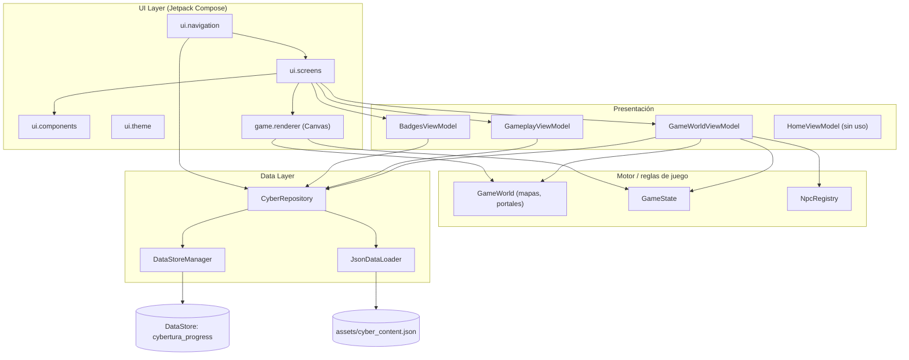
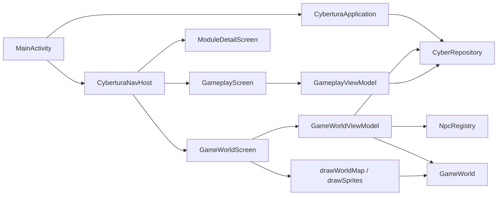
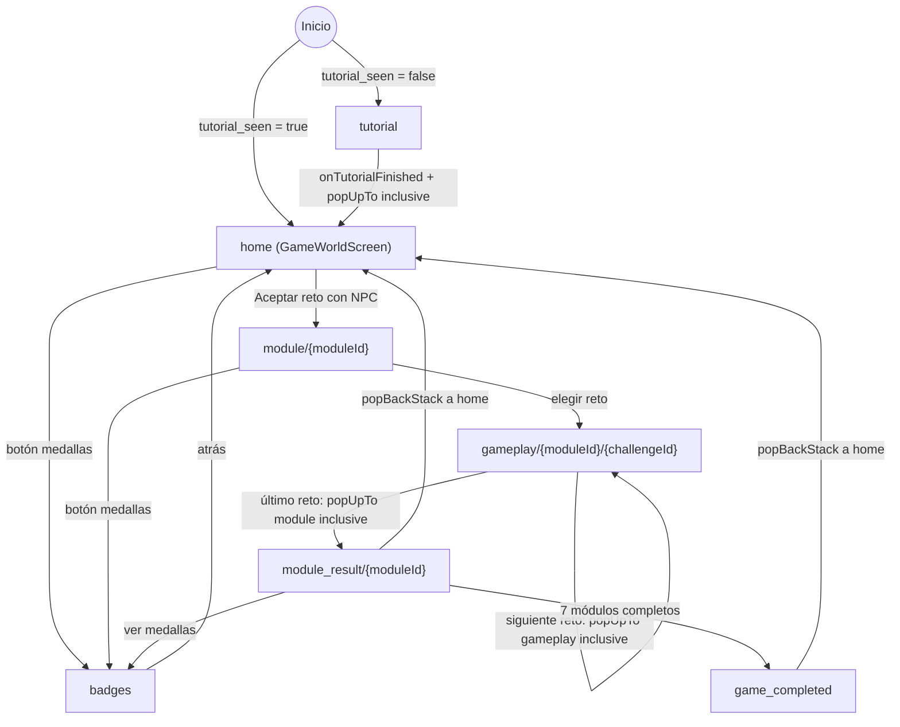
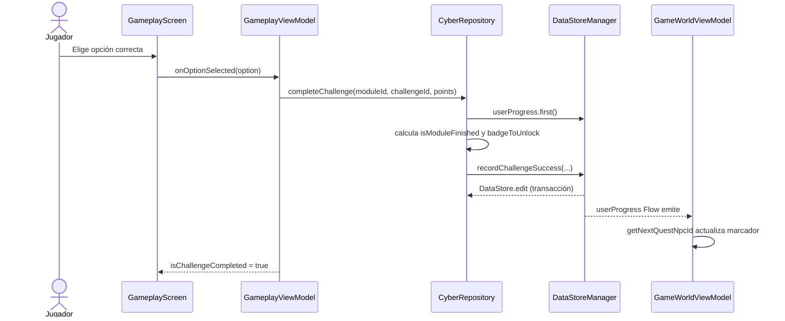
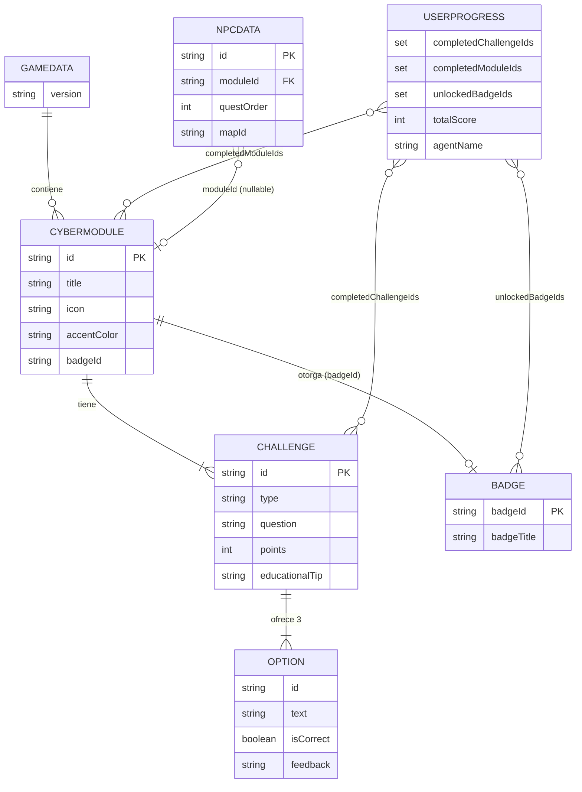

# CyberTura — Documentación Técnica

> **Desarrollo de un prototipo de juego móvil educativo para el aprendizaje de conceptos básicos de ciberseguridad en niños de 11 a 12 años de Bucaramanga: "Cybertura, una aventura de ciberseguridad"**
> Auditoría de código fuente y documentación técnica del prototipo, complementaria al anteproyecto de Proyecto de Grado.

| Campo | Valor |
|---|---|
| Aplicación | `cybertura` (`applicationId = com.example.cybertura`) |
| Versión | `versionName 1.0` / `versionCode 1` (`app/build.gradle.kts`) |
| Plataforma | Android nativo, Kotlin + Jetpack Compose |
| Código analizado | 7 234 líneas Kotlin, 1 módulo Gradle (`:app`) |
| Fecha de auditoría | 2026-10-06 |
| Autor | Santiago Matajira Rueda |
| Nivel de madurez objetivo | TRL 4 (prototipo funcional validado en entorno controlado), según el anteproyecto |

> Los datos de autoría y del contexto académico provienen del anteproyecto aportado por el autor, no del repositorio.

**Convención de rutas.** Para abreviar, `<pkg>` equivale a `app/src/main/java/com/example/cybertura`. Las referencias de línea corresponden al estado del repositorio en la fecha de auditoría.

**Convención de estado.** ✅ implementado · 🟡 parcial / a medias · ⚪ declarado sin uso · ❌ no implementado.

---

## Tabla de contenidos

1. [Portada y resumen ejecutivo](#1-portada-y-resumen-ejecutivo)
2. [Stack tecnológico](#2-stack-tecnológico)
3. [Arquitectura del sistema](#3-arquitectura-del-sistema)
4. [Estructura del proyecto](#4-estructura-del-proyecto)
5. [Funcionalidades implementadas](#5-funcionalidades-implementadas)
6. [Interfaz de usuario con Jetpack Compose](#6-interfaz-de-usuario-con-jetpack-compose)
7. [Base de datos y persistencia](#7-base-de-datos-y-persistencia)
8. [Inteligencia Artificial](#8-inteligencia-artificial)
9. [Integraciones externas y APIs](#9-integraciones-externas-y-apis)
10. [Seguridad y privacidad](#10-seguridad-y-privacidad)
11. [Calidad del código y pruebas](#11-calidad-del-código-y-pruebas)
12. [Configuración y ejecución](#12-configuración-y-ejecución)
13. [Limitaciones y trabajo futuro](#13-limitaciones-y-trabajo-futuro)
14. [Anexos](#14-anexos)

---

## 1. Portada y resumen ejecutivo

### 1.1 Propósito
CyberTura es una aplicación móvil que enseña **ciudadanía y seguridad digital** a niños mediante un mundo RPG 2D de vista cenital. El jugador recorre una ciudad, conversa con 7 "maestros" (NPC) en un orden fijo y resuelve retos de opción múltiple o de escenario de decisión. Al completar los retos de un módulo obtiene puntos de experiencia (XP) y una medalla.

Evidencia: orden y diálogos de los maestros en `<pkg>/game/engine/NpcData.kt` (`NpcRegistry.npcs`); contenido pedagógico en `app/src/main/assets/cyber_content.json`.

### 1.2 Problema que resuelve
Transmitir buenas prácticas de seguridad digital (contraseñas, phishing, privacidad, ciberacoso, redes sociales, Wi-Fi/dispositivos, juegos en línea) en un formato lúdico y con retroalimentación inmediata. El texto de la app y los diálogos usan un tono dirigido a público infantil (`Color.kt`: "Fantasía Cibernética para Niños"; `NpcData.kt`).

### 1.3 Usuarios objetivo
- **Usuarios primarios:** niños de **11 a 12 años** de Bucaramanga, estudiantes de sexto y séptimo grado (anteproyecto, §2 y §7.2).
- **Usuarios secundarios** (según el anteproyecto): docentes de informática/tecnología y familias, como apoyo complementario. **El código no incluye ninguna funcionalidad específica para ellos** (sin panel docente ni reportes).
- El repositorio no declara el rango de edad en código ni metadatos; la adecuación al público infantil se infiere del tono de los diálogos (`NpcData.kt`) y de comentarios de diseño (`Color.kt`).

### 1.4 Alcance del sistema

| Aspecto | Estado |
|---|---|
| Aplicación 100 % offline, un solo dispositivo | ✅ |
| 7 módulos educativos, 16 retos en total | ✅ (`cyber_content.json`) |
| Mundo 2D con exterior (50×50 tiles) y 4 interiores | ✅ (`GameWorld.kt`) |
| Progreso, nivel, medallas persistentes | ✅ (`DataStoreManager.kt`) |
| Tutorial de primera ejecución | ✅ (`TutorialScreen.kt`) |
| Cuentas de usuario, backend, red | ❌ No implementado |
| Inteligencia artificial | ❌ No implementado |
| Sonido / música | ❌ No implementado (no se encontró `MediaPlayer`, `SoundPool` ni recursos `raw`) |
| Panel docente / reportes | ❌ No implementado |

### 1.5 Trazabilidad con el anteproyecto

Esta sección contrasta lo que el anteproyecto promete con lo que el código implementa realmente. Fuente del compromiso: anteproyecto (objetivos §4, alcance §5, diseño metodológico §7, resultados §8).

#### 1.5.1 Objetivos específicos

| Objetivo específico del anteproyecto | Evidencia en el código | Estado |
|---|---|---|
| **OE1.** Determinar riesgos digitales y conceptos básicos pertinentes para 11–12 años | Catálogo de contenidos en `cyber_content.json`: 7 módulos. Cubre los 5 temas del alcance (contraseñas, phishing, privacidad, ciberacoso, redes sociales) y añade **Wi-Fi/dispositivos** y **juegos en línea**. Ciberacoso y redes sociales tienen solo 1 reto cada uno. | ✅ Implementado, con cobertura desigual |
| **OE2.** Diseñar estructura interactiva y mecánicas de gamificación | XP y 8 rangos (`UserProgress`), medallas (`BadgesScreen`), narrativa RPG con 7 maestros en orden fijo (`NpcRegistry`), retroalimentación inmediata (`FeedbackModal`). Corresponde a los elementos citados en el anteproyecto (puntos, niveles, insignias, recompensas, progresión narrativa; Deterding et al., 2011). | ✅ Implementado |
| **OE3.** Construir un prototipo funcional con contenidos y simulaciones básicas | App Android instalable. Hay 16 retos: 9 `DECISION_SCENARIO` (escenarios de decisión) y 7 `MULTIPLE_CHOICE`. La UI no distingue ambos tipos (ver §7.3). | ✅ Implementado |
| **OE4.** Pruebas piloto para analizar comprensión y usabilidad | **Fuera del código.** La app no incluye pretest/postest, encuesta SUS ni formato de observación (son instrumentos externos, Anexos D–G del anteproyecto). No hay evidencia en el repositorio de que el piloto se haya ejecutado. | ⏳ No verificable desde el código |

#### 1.5.2 Discrepancia de arquitectura tecnológica

El anteproyecto (§7.3, §7.7, §7.8, §8) describe una **arquitectura híbrida: Unity 2D + Android Studio con Kotlin**. El código auditado es **100 % Android nativo con Kotlin y Jetpack Compose**:

| Aspecto | Anteproyecto | Código real | Evidencia |
|---|---|---|---|
| Motor de juego | Unity 2D | Motor propio sobre `Canvas` de Compose (`GameWorldViewModel`, `WorldRenderer.kt`, `SpriteRenderer.kt`) | §5.4 |
| Módulos Gradle | App + integración de Unity | Solo `:app` | `settings.gradle.kts` |
| Dependencias de Unity | Previstas | Ninguna | `app/build.gradle.kts` |
| Lenguaje | Kotlin (integración) + C# (Unity) | Solo Kotlin | `src/main/java` |

**Implicación para la tesis:** la memoria final debe describir la arquitectura realmente construida y justificar el cambio. La Tabla 3 del anteproyecto respalda la opción C (aplicación nativa Android con Kotlin): rendimiento alto, uso sin conexión alto, integración con Android alta, costo bajo. No se encontró en el repositorio documento que registre la decisión de abandonar Unity.

#### 1.5.3 Alcance y delimitación (anteproyecto §5)

| Restricción del anteproyecto | Cumplimiento verificado |
|---|---|
| Sin integración con bases de datos externas | ✅ Solo DataStore local y JSON en `assets` (§7) |
| Sin autenticación avanzada | ✅ Sin cuentas ni login |
| Sin funcionalidades complejas de conectividad | ✅ Sin permiso `INTERNET` ni dependencias de red (§9) |
| Módulos de navegación, niveles, preguntas, retroalimentación, recompensas y progreso local (anteproyecto §8) | ✅ Todos presentes (§5) |
| Prototipo TRL 4, sin despliegue comercial | ✅ Coherente: `applicationId` provisional, sin R8 ni firma (§10) |

#### 1.5.4 Variables e indicadores de evaluación (anteproyecto, Tabla 4)

| Variable | Indicador del anteproyecto | ¿Medible con lo implementado en la app? |
|---|---|---|
| Compatibilidad Android | Pruebas en 2 versiones | El código declara `minSdk 24` y `targetSdk 37`. **No se pudo verificar** en qué versiones se probó. |
| Tiempo de carga | < 5 s | No medido. La carga es ligera (JSON de ~28 KB, 26 recursos), pero no hay mediciones. |
| Estabilidad | < 5 fallos por prueba | No medido. No hay herramienta de reporte de fallos (sin Crashlytics). |
| Facilidad de uso | SUS ≥ 80 | Instrumento externo; no está en la app. |
| Interacción | Tiempo activo por sesión | **La app no registra sesiones ni tiempos.** Solo cabe observación directa. |
| Aprendizaje logrado | Pretest y postest | Instrumento externo. La app guarda los retos acertados, pero **no guarda intentos fallidos**, por lo que no aporta datos de error por concepto. |
| Motivación | Encuesta de satisfacción | Instrumento externo. |

#### 1.5.5 Consideraciones éticas (anteproyecto §6.3.1)

- **Coherente con el diseño:** la app no recoge datos personales, no usa red y guarda solo un alias por defecto (`"Ciber-Detective"`) y el progreso (§10, S2–S3).
- **Tono no alarmista:** los comentarios de `Color.kt` indican "sin tonos alarmistas" y el feedback de error es de reintento sin penalización (`GameplayViewModel`), alineado con el compromiso de no generar ansiedad.
- **A decidir:** `allowBackup="true"` puede copiar el progreso a la nube de Google del dispositivo (§10, S5); conviene fijarlo conscientemente dado que el usuario es menor de edad.

#### 1.5.6 Relación con la propuesta de IA
El anteproyecto no contempla IA y excluye conectividad compleja. Por eso las ideas del §8.2 se plantean solo como **trabajo futuro**, en línea con las "futuras mejoras" que menciona el anteproyecto (más niveles, conexión en línea, estadísticas de desempeño).

---

## 2. Stack tecnológico

Fuentes: `gradle/libs.versions.toml`, `app/build.gradle.kts`, `settings.gradle.kts`.

| Tecnología | Versión | Uso | Archivo |
|---|---|---|---|
| Kotlin | 2.2.10 | Lenguaje único | `libs.versions.toml` |
| Plugin `kotlin.compose` | 2.2.10 | Compilador de Compose | `build.gradle.kts` (raíz y app) |
| Android Gradle Plugin | 9.4.1 | Build | `libs.versions.toml` |
| Compose BOM | 2026.02.01 | Alinea versiones de Compose | `app/build.gradle.kts:39` |
| Material 3 (`material3`) | por BOM | Tema oscuro, `Scaffold`, `Surface`, `Button` | `ui/theme/Theme.kt` |
| Compose UI / Graphics / Tooling Preview | por BOM | `Canvas`, `DrawScope`, animaciones | `GameWorldScreen.kt`, `game/renderer/*` |
| `material-icons-extended` | por BOM | Iconos de UI | `CyberComponents.kt`, `GameplayScreen.kt` |
| `activity-compose` | 1.8.0 | `setContent`, `enableEdgeToEdge` | `MainActivity.kt` |
| `core-ktx` | 1.10.1 | Extensiones KTX | `app/build.gradle.kts` |
| `lifecycle-runtime-ktx` | 2.6.1 | Ciclo de vida | `app/build.gradle.kts` |
| `lifecycle-viewmodel-compose` | 2.8.7 | `viewModel()` en Compose | `CyberturaNavHost.kt` |
| `navigation-compose` | 2.8.8 | Navegación entre pantallas | `ui/navigation/*` |
| `datastore-preferences` | 1.1.2 | Persistencia del progreso | `data/local/DataStoreManager.kt` |
| Gson | 2.11.0 | Parseo del JSON de contenido | `data/local/JsonDataLoader.kt` |
| Corrutinas / Flow | transitiva | Game loop, estado reactivo | `GameWorldViewModel.kt` |
| `foojay-resolver-convention` | 1.0.0 | Resolución de toolchains JDK | `settings.gradle.kts` |
| JUnit 4 | 4.13.2 | Pruebas unitarias | `src/test` |
| AndroidX Test JUnit / Espresso / Compose UI Test | 1.1.5 / 3.5.1 / por BOM | Pruebas instrumentadas (solo plantilla) | `src/androidTest` |

### 2.1 Parámetros de compilación (`app/build.gradle.kts`)

| Parámetro | Valor |
|---|---|
| `compileSdk` | 37 (`release(37)`) |
| `targetSdk` | 37 |
| `minSdk` | 24 |
| Java / bytecode | 11 |
| `buildFeatures.compose` | `true` |
| `buildTypes.release` | `optimization { enable = false }` (sin R8/minify) |
| Instrumentación | `androidx.test.runner.AndroidJUnitRunner` |

### 2.2 Tecnologías **no** presentes (verificado)
Se revisaron `libs.versions.toml`, `build.gradle.kts` y el código fuente. No existen: Hilt/Dagger, Koin, Room, Retrofit/OkHttp/Ktor, WorkManager, Firebase, Coil, ni `google-services.json`. La inyección de dependencias es manual (ver §3).

---

## 3. Arquitectura del sistema

### 3.1 Descripción de la arquitectura implementada
La app es un **monolito de un módulo** (`:app`) organizado por capas en paquetes:

| Paquete | Rol | Contenido |
|---|---|---|
| `data.local` | Fuentes de datos | `DataStoreManager`, `JsonDataLoader` |
| `data.model` | Modelos de datos | `ContentModels.kt` (DTO/modelo de contenido), `UserProgress` |
| `data.repository` | Repositorio | `CyberRepository` |
| `game.engine` | Motor y reglas del juego | `GameWorld`, `GameState`, `NpcRegistry` |
| `game.renderer` | Render en Canvas | `WorldRenderer.kt`, `SpriteRenderer.kt` |
| `ui.viewmodel` | Presentación | `GameWorldViewModel`, `GameplayViewModel`, `BadgesViewModel`, `HomeViewModel` |
| `ui.screens` | Pantallas Composable | 8 pantallas (7 conectadas + `HomeScreen` descartada) |
| `ui.components` | Componentes reutilizables | `CyberComponents.kt` |
| `ui.navigation` | Navegación | `Screen`, `CyberturaNavHost` |
| `ui.theme` | Sistema de diseño | `Color`, `Type`, `Theme` |

**Patrón de presentación: MVVM con flujo de datos unidireccional (UDF).** Los `ViewModel` exponen `StateFlow<UiState>`; las pantallas lo observan con `collectAsState()` y envían eventos mediante lambdas (`onOptionSelected`, `onNavigateNext`, etc.). Ejemplo: `CyberturaNavHost.kt` (ruta `Gameplay`) conecta `GameplayViewModel.uiState` con `GameplayScreen`.

**Inyección de dependencias manual.** `CyberturaApplication.onCreate()` construye `JsonDataLoader` → `DataStoreManager` → `CyberRepository` y los guarda en la propiedad `repository`. `MainActivity` la recupera con `(application as CyberturaApplication).repository` y la pasa a `CyberturaNavHost`. Cada `ViewModel` se crea con un `ViewModelProvider.Factory` propio (`provideFactory(...)`).

**Particularidad:** el motor del juego no está separado de la capa de presentación. `GameWorldViewModel` contiene el *game loop*, la física, las colisiones y la IA de los NPC, y actúa a la vez como ViewModel y como motor.

### 3.2 Diagrama de capas



La capa de dominio (Domain Layer) **no existe como tal**: no hay casos de uso. Las reglas de negocio están repartidas entre `CyberRepository.completeChallenge` (desbloqueo de medalla), `UserProgress` (nivel y rango) y `GameWorldViewModel`/`NpcRegistry` (orden de misiones).

### 3.3 Dependencias entre componentes principales



### 3.4 Comparación con arquitecturas de referencia

| Referencia | Cumplimiento | Evidencia |
|---|---|---|
| **Guía de arquitectura de Android — UI Layer** | ✅ Alto | Pantallas Compose + `StateFlow<UiState>` (`GameplayUiState`, `BadgesUiState`); `ViewModel` con `viewModelScope`. |
| **— Domain Layer** | ❌ Ausente (opcional según la guía) | No hay `UseCase`. La lógica vive en repositorio y ViewModel. |
| **— Data Layer** | 🟡 Parcial | `CyberRepository` es la única fuente de verdad para la UI, con `Flow` desde DataStore. Faltan interfaces y separación DTO/entidad/modelo de dominio. |
| **MVVM** | ✅ | Ver §3.1. |
| **MVI** | ❌ | No hay `Intent`/`Event` sellados ni reducer. Los eventos son métodos públicos del ViewModel. |
| **Clean Architecture** | ❌ | Sin capa de dominio ni inversión de dependencias: `CyberRepository` es clase concreta, instanciada en `Application`. |
| **UDF** | 🟡 Mayormente | Estado hacia abajo, eventos hacia arriba. Excepciones: `ModuleDetailScreen` y `ModuleResultScreen` reciben modelos obtenidos directamente de `repository.getModuleById()` dentro del NavHost (`CyberturaNavHost.kt`), sin ViewModel. |

### 3.5 Evaluación de principios

| Principio | Valoración | Fundamento |
|---|---|---|
| **S** — Responsabilidad única | 🟡 Violado en puntos | `GameWorldViewModel` (397 líneas) mezcla bucle de juego, física, colisiones, IA de NPC, lluvia, portales y lógica de diálogos. `GameWorld.kt` mezcla definición de tiles, generación procedural del mapa, interiores y portales. |
| **O** — Abierto/cerrado | 🟡 | Añadir un NPC o módulo es declarativo (`NpcRegistry`, JSON). Añadir un tile obliga a editar `TileType`, constantes, `tileTypes` y el renderer. |
| **L** — Liskov | ✅ N/A | No hay jerarquías de herencia relevantes (`Screen` es `sealed class`). |
| **I** — Segregación de interfaces | ⚪ N/A | No hay interfaces propias. |
| **D** — Inversión de dependencias | ❌ Violado | `CyberRepository` depende de clases concretas `JsonDataLoader` y `DataStoreManager`. Los ViewModels reciben el repositorio concreto. `GameWorld` y `NpcRegistry` son `object` (singleton global). |
| Separación de responsabilidades | 🟡 | Capas de paquetes claras en datos y UI; el motor del juego se confunde con presentación. |
| Acoplamiento | 🟡 | La UI conoce directamente `NpcRegistry`, `GameWorld` y `MapIds` (p. ej. `GameWorldScreen.kt`, `CyberturaNavHost.kt:147`). |
| Testabilidad | 🟡 Baja–media | `UserProgress` es testeable (tiene pruebas). `CyberRepository`/ViewModels no son testeables sin Android: dependen de `Context` y no hay interfaces ni inyección de dispatchers. `GameWorldViewModel` usa `System.currentTimeMillis()` y `Math.random()` directamente, lo que impide pruebas deterministas. |

---

## 4. Estructura del proyecto

```text
cybertura/
├── build.gradle.kts                 # plugins raíz (application, kotlin.compose) con apply false
├── settings.gradle.kts              # repositorios, foojay, include(":app")
├── gradle.properties                # -Xmx2048m, configuration-cache=true, kotlin.code.style=official
├── gradle/libs.versions.toml        # catálogo de versiones
├── local.properties                 # solo sdk.dir (ignorado por git)
└── app/
    ├── build.gradle.kts             # config Android + dependencias
    ├── docs/                        # esta documentación
    └── src/
        ├── main/
        │   ├── AndroidManifest.xml  # 1 Application, 1 Activity, sin permisos
        │   ├── assets/cyber_content.json   # 7 módulos / 16 retos (~28 KB)
        │   ├── java/com/example/cybertura/
        │   │   ├── CyberturaApplication.kt # composition root (DI manual)
        │   │   ├── MainActivity.kt         # edge-to-edge + tema + NavHost
        │   │   ├── data/
        │   │   │   ├── local/   DataStoreManager.kt, JsonDataLoader.kt
        │   │   │   ├── model/   ContentModels.kt, UserProgress.kt
        │   │   │   └── repository/ CyberRepository.kt
        │   │   ├── game/
        │   │   │   ├── engine/  GameState.kt, GameWorld.kt, NpcData.kt
        │   │   │   └── renderer/ WorldRenderer.kt, SpriteRenderer.kt
        │   │   └── ui/
        │   │       ├── components/ CyberComponents.kt
        │   │       ├── navigation/ Screen.kt, CyberturaNavHost.kt
        │   │       ├── screens/    GameWorldScreen, TutorialScreen, ModuleDetailScreen,
        │   │       │               GameplayScreen, ModuleResultScreen, BadgesScreen,
        │   │       │               GameCompletedScreen, HomeScreen (descartada)
        │   │       ├── theme/      Color.kt, Type.kt, Theme.kt
        │   │       └── viewmodel/  GameWorldVM, GameplayVM, BadgesVM, HomeVM (huérfano)
        │   └── res/
        │       ├── drawable/       sprites PNG de tiles y personajes + iconos launcher
        │       ├── mipmap-*/       iconos
        │       ├── values/         strings (solo app_name), colors, themes
        │       └── xml/            backup_rules, data_extraction_rules (plantillas)
        ├── test/       ContentAndProgressUnitTest.kt, ExampleUnitTest.kt
        └── androidTest/ ExampleInstrumentedTest.kt
```

Observaciones: no existe `app/proguard-rules.pro` ni `app/consumer-rules`; no hay `res/font`; hay 26 archivos en `drawable` (24 PNG de 0,3 a 7,7 KB y 2 vectores del launcher).

---

## 5. Funcionalidades implementadas

### 5.1 Resumen

| # | Funcionalidad | Estado | Pantallas | Clases clave |
|---|---|---|---|---|
| F1 | Tutorial de primera ejecución | ✅ | `TutorialScreen` | `CyberturaNavHost`, `DataStoreManager.markTutorialSeen` |
| F2 | Mundo explorable 2D | ✅ | `GameWorldScreen` | `GameWorldViewModel`, `GameWorld`, `WorldRenderer`, `SpriteRenderer` |
| F3 | NPC y cadena de misiones | ✅ | `GameWorldScreen` | `NpcRegistry`, `NpcData` |
| F4 | Interiores de casas y portales | ✅ | `GameWorldScreen` | `GameWorld.portals`, `portalAt` |
| F5 | Guía de objetivo (banner, brújula, flecha en puerta) | ✅ | `GameWorldScreen` | `ObjectiveBanner`, `drawCompassArrow`, `drawDoorGuide` |
| F6 | Detalle de módulo / registro de retos | ✅ | `ModuleDetailScreen` | `CyberRepository.getModuleById` |
| F7 | Retos educativos con retroalimentación | ✅ | `GameplayScreen` | `GameplayViewModel`, `FeedbackModal` |
| F8 | XP, nivel y rango | ✅ | `CyberTopBar`, `GameCompletedScreen` | `UserProgress` |
| F9 | Medallas / trofeos | ✅ | `BadgesScreen` | `BadgesViewModel`, `CyberRepository.completeChallenge` |
| F10 | Resultado de módulo y final del juego | ✅ | `ModuleResultScreen`, `GameCompletedScreen` | `CyberturaNavHost` |
| F11 | Lluvia digital y ambientación | ✅ | `GameWorldScreen` | `Particle`, `GameWorldViewModel.updateGame` |
| F12 | Pantalla de inicio con módulos (`HomeScreen`) | ⚪ Descartada (confirmado por el autor; código sin conectar) | — | `HomeScreen`, `HomeViewModel` |
| F13 | Reinicio de progreso | 🟡 Solo en repositorio | — | `CyberRepository.resetProgress` (único consumidor: `HomeViewModel`, sin uso) |
| F14 | Nombre de agente editable | 🟡 | — | `DataStoreManager.setAgentName`; no se encontró ninguna llamada desde la UI ni el repositorio. |

### 5.2 Diagrama de navegación

Rutas definidas en `ui/navigation/Screen.kt`; grafo en `CyberturaNavHost.kt`. Es un **grafo plano** (sin grafos anidados).



Detalles:

- **Destino inicial.** `CyberturaNavHost` observa `repository.tutorialSeen` con `collectAsState(initial = null)`. Mientras es `null` ejecuta `return` y no compone nada (`CyberturaNavHost.kt`, líneas 29–36).
- **Argumentos.** `moduleId` y `challengeId` son `NavType.StringType`; se leen de `backStackEntry.arguments`.
- **Final del juego.** `ModuleResultScreen.onGoHome` navega a `game_completed` cuando `completedModuleIds.size >= NpcRegistry.questNpcs.size` (7).

### 5.3 F1 — Tutorial
- **Flujo:** 9 diapositivas (`questNpcs.size + 2`): bienvenida, un slide por maestro (usa `NpcData.tutorialDialog`) y cierre. Transición horizontal con `AnimatedContent`.
- **Persistencia:** al finalizar se lanza `repository.markTutorialSeen()` y se navega a `home`.
- **Observación:** el comentario del archivo habla de "5 maestros", pero el código usa `NpcRegistry.questNpcs.size` (7); el comentario está desactualizado.

### 5.4 F2–F5 — Mundo, NPC, interiores y guía

**Motor.** `GameWorldViewModel` arranca un bucle en `viewModelScope` al inicializarse:

```kotlin
// <pkg>/ui/viewmodel/GameWorldViewModel.kt (startGameLoop)
while (isGameLoopRunning) {
    val frameStart = System.currentTimeMillis()
    val dt = ((frameStart - currentState.lastFrameTimeMs) / 1000f).coerceAtMost(0.1f)
    updateGame(dt, frameStart)
    delay((16L - elapsed).coerceAtLeast(1L))
}
```

Cada tick (≈60 Hz objetivo) `updateGame` calcula: movimiento por joystick con zona muerta de 0,1; colisión eje por eje con 4 esquinas y margen 0,25 (`canMoveTo`); cambio de mapa por portal; NPC más cercano dentro de 1,8 tiles; 50 partículas de lluvia; animación de caminata (alterna cada 250 ms); y paseo aleatorio de NPC dentro de su `wanderRadius`.

**Mundo.**

| Elemento | Detalle | Fuente |
|---|---|---|
| Mapa exterior | 50×50 tiles, `TILE_SIZE = 56f`, generado por función determinista `generateMapTile` | `GameWorld.kt` |
| Zonas | Océano oeste, montaña norte y este, bosque sur, ciudad central con cruz de caminos, Academia (7×4), mazmorra (4×3), 4 casas, lago interior, cementerio | `GameWorld.kt` |
| Interiores | 4 mapas de 11×9 definidos como cadenas de texto (`layoutHomeRed`, `layoutHomeBlue`, `layoutWorkshop`, `layoutGamer`) | `GameWorld.kt` |
| Portales | 8 (entrada y salida de cada casa) | `GameWorld.portals` |
| Spawn | (25, 30) | `GameWorld.playerSpawnX/Y` |

**NPC (14 en total).**

| Orden | ID | Nombre | Módulo | Mapa |
|---|---|---|---|---|
| 1 | `npc_bullying` | Líder Heart | `module_cyberbullying` | exterior (plaza) |
| 2 | `npc_passwords` | Guardián Key | `module_passwords` | exterior |
| 3 | `npc_wifi` | Técnica Wifi | `module_wifi` | `house_red_s` |
| 4 | `npc_privacy` | Escudera Shield | `module_privacy` | exterior |
| 5 | `npc_phishing` | Capitán Anzuelo | `module_phishing` | exterior (muelle) |
| 6 | `npc_gaming` | Capitán Joystick | `module_gaming` | `house_blue_s` |
| 7 | `npc_social` | Maestro Cyber | `module_social_networks` | exterior (academia) |
| — | `npc_villager_1..3` | Turista, Pescador, Niño | — | exterior |
| — | `npc_abuela`, `npc_tio_bits`, `npc_mama_cora`, `npc_hermana_luna` | Habitantes | — | interiores |

**Reglas de la cadena de misiones.** `NpcRegistry.getNextQuestNpcId(completedModuleIds)` devuelve el primer maestro cuyo módulo no está completado. En `GameWorldViewModel.interact()`, si el NPC no es el objetivo actual, el diálogo se bloquea: "ya completado" (`completedDialog`) o "todavía no es tu momento" con una pista de ubicación. Solo los diálogos no bloqueados muestran **"¡Aceptar Reto!"**, que navega a `module/{moduleId}`.

**Guía al jugador.** `ObjectiveBanner` (HUD) describe el objetivo según el mapa actual. En `SpriteRenderer.kt`, `drawDoorGuide` resalta la puerta a usar y `drawCompassArrow` dibuja una flecha dorada hacia el destino; los NPC objetivo muestran un "!" pulsante (`drawQuestBang`).

**Pipeline de render** (`GameWorldScreen.kt`, `Canvas`):
1. `drawWorldMap` → exterior en dos pasadas (suelo y objetos), o interior con paleta cálida/fría según el ID del mapa.
2. `drawSprites` → guía de puerta, NPC, jugador, brújula.
3. Capa de oscurecimiento: `alpha = 0.45` en la calle y `0.1` en interiores.
4. Gotas de lluvia como rectángulos de `NeonCyan`.
5. Fundido a negro de 450 ms al cambiar de mapa y cartel con el nombre del lugar (2,6 s).

### 5.5 F6–F7 — Módulos y retos
- `ModuleDetailScreen` muestra el módulo, su progreso (`getModuleProgressPercentage`) y la lista de retos. El botón principal lanza el primer reto sin completar, o el primero si todos están completos (`nextChallenge`, líneas 49–50).
- `GameplayScreen` presenta la historia (`storyContext`), la pregunta y 3 opciones (`BattleOptionCard`). Al elegir, `GameplayViewModel.selectOption` fija el feedback y, si es correcta, llama a `repository.completeChallenge(...)`.
- Una respuesta incorrecta permite reintentar (`dismissFeedback`); no hay límite de intentos ni penalización.
- Tras una respuesta correcta, el modal ofrece "siguiente" o, si es el último reto, el resultado del módulo.

### 5.6 F8–F10 — Progreso, medallas y final



- **XP.** `UserProgress.XP_PER_LEVEL = 200`; `level = totalScore / 200 + 1`; 8 rangos desde "Novato Digital" hasta "Campeón Legendario" (nivel 8 o superior). Cada reto vale 100 puntos en los 16 retos del JSON; 16 × 100 = 1 600 puntos máximos (nivel 9).
- **Puntos.** Solo se suman la primera vez que se completa el reto (`DataStoreManager.recordChallengeSuccess`, `wasAlreadyCompleted`).
- **Medalla.** Se desbloquea cuando todos los retos del módulo están completados (`CyberRepository.completeChallenge`).

---

## 6. Interfaz de usuario con Jetpack Compose

### 6.1 Sistema de diseño
- **Tema.** Solo esquema **oscuro** (`CyberturaDarkRpgScheme`, `darkColorScheme`) en `ui/theme/Theme.kt`. El parámetro `darkTheme` de `CyberturaTheme` **no se usa**. No hay *dynamic color* ni tema claro.
- **Paleta** (`Color.kt`): fondos `Dungeon*`, acentos `Neon*`, textos `Text*`, estados `Quest*`, rarezas `Rarity*` y *alias legacy* `Cyber*`. Colores `Module*` solo para 5 de los 7 módulos; el JSON define el color real de cada módulo en `accentColor`, que se interpreta con `Color.parseColor` (con `try/catch`, p. ej. `GameplayScreen.kt:47`).
- **Tipografía** (`Type.kt`): escala completa de `Typography` con `FontFamily.Default`; no hay fuentes personalizadas.
- **Estética del mundo.** Sprites PNG con `FilterQuality.None` (pixel art nítido) y formas geométricas dibujadas con `DrawScope` para casas, cercas, acantilados e interiores.

### 6.2 Componentes reutilizables (`ui/components/CyberComponents.kt`)

| Componente | Función |
|---|---|
| `PulsingGlowBox` | Contenedor con halo pulsante |
| `XpBar` | Barra de experiencia |
| `CyberTopBar` | HUD superior: agente, puntos, nivel, rango, medallas, atrás opcional |
| `CyberModuleIcon` | Traduce la cadena `icon` del JSON a un `ImageVector` |
| `FeedbackModal` | Modal de victoria/reintento con consejo educativo |
| `FloatingParticles` | Fondo animado de partículas |
| `RarityBorderModifier` | Borde por rareza; definido pero **no se encontraron usos fuera de su declaración** |

Los iconos de módulo son aproximados: `"wifi"` se muestra con `Icons.Default.Home` y `"sports_esports"` con `Icons.Default.Star` (`CyberComponents.kt:408-409`).

### 6.3 Manejo de estado

| Mecanismo | Dónde |
|---|---|
| `StateFlow` + `collectAsState()` | `GameWorldScreen`, `GameplayScreen` (vía NavHost), `BadgesScreen` |
| `collectAsState(initial = UserProgress())` directo del repositorio | Varias rutas del NavHost |
| `remember` / `mutableStateOf` | Joystick, texto del diálogo, ficha del lugar, diapositiva del tutorial |
| `remember { ... }` con `ImageBitmap.imageResource` | Carga única de sprites (`GameWorldScreen.kt:57-100`) |
| `Animatable`, `rememberInfiniteTransition` | Fundido de portales, pulso del botón A |
| `AnimatedVisibility` / `AnimatedContent` | Diálogo, cartel de lugar, tutorial |

### 6.4 Patrones de recomposición y rendimiento

- **Punto crítico.** `GameWorldScreen` hace `val gameState by viewModel.gameState.collectAsState()` sobre el estado completo. Como `updateGame` emite un `GameState` nuevo en cada tick (cambian `frameCount`, `lastFrameTimeMs` y `particles`), **todo el contenido de la pantalla se recompone ~60 veces por segundo**, incluidos HUD, banner y botones.
- **Mitigaciones existentes:** los bitmaps se cachean con `remember`; el área visible del mapa se limita a las celdas que caben en pantalla (`startCol..endCol`); las partículas se limitaron a 50 (comentario en `updateGame`).
- **Costes por tick:** se recrea la lista de partículas (`map` + `copy`) y el mapa de NPC (`mapValues`) aunque nada cambie para esos elementos.
- **Estabilidad de parámetros:** `GameState` es `data class` con `List` y `Map` (tipos que el compilador considera inestables en Compose, sin `@Immutable`/`@Stable`).

### 6.5 Accesibilidad
- Hay 9 `Icon`/`Image` con `contentDescription = null` (`GameplayScreen.kt:281`, `HomeScreen.kt:477,526`, `ModuleDetailScreen.kt:112,500`, `BadgesScreen.kt:319`, `ModuleResultScreen.kt:288`, `CyberComponents.kt:460,536`); algunos son decorativos, pero no se verificó caso por caso.
- El mundo del juego es un `Canvas` sin semántica (`semantics`): el joystick y el mapa no son accesibles con TalkBack.
- Solo hay 1 recurso de cadena (`app_name`): **todo el texto está incrustado en el código**, sin localización (i18n).
- Los tamaños de texto usan `sp` (escalan con la configuración del usuario); no se comprobó contraste ni tamaño mínimo de toque.
- No se encontró uso de `@Preview` en el código.

---

## 7. Base de datos y persistencia

### 7.1 Motor y tecnología
La app **no usa base de datos relacional ni remota** (no hay Room/SQLite explícito, Firebase ni API). Utiliza dos almacenes:

| Almacén | Tecnología | Acceso | Archivo |
|---|---|---|---|
| Progreso del usuario | **Jetpack DataStore Preferences**, nombre `cybertura_progress` | Lectura/escritura | `DataStoreManager.kt` |
| Contenido educativo | **JSON en `assets/`** (`cyber_content.json`) | Solo lectura | `JsonDataLoader.kt` |

### 7.2 Esquema de DataStore (clave–valor)

| Clave | Tipo | Valor por defecto | Significado |
|---|---|---|---|
| `completed_challenges` | `Set<String>` | vacío | IDs de retos resueltos |
| `completed_modules` | `Set<String>` | vacío | IDs de módulos terminados |
| `unlocked_badges` | `Set<String>` | vacío | IDs de medallas |
| `total_score` | `Int` | 0 | XP acumulada |
| `agent_name` | `String` | `"Ciber-Detective"` | Nombre del jugador |
| `tutorial_seen` | `Boolean` | `false` | Tutorial ya mostrado |

### 7.3 Esquema del contenido (JSON → modelos Gson)

Modelos en `data/model/ContentModels.kt`. El JSON tiene un campo `version` ("1.0") y la lista `modules`.

| Entidad | Campos | Clave |
|---|---|---|
| `GameData` | `version`, `modules` | — |
| `CyberModule` | `id`, `title`, `subtitle`, `description`, `icon`, `accentColor`, `badgeId`, `badgeTitle`, `badgeDescription`, `challenges` | `id` |
| `Challenge` | `id`, `title`, `type`, `storyContext`, `question`, `points`, `educationalTip`, `options` | `id` |
| `Option` | `id`, `text`, `isCorrect`, `feedback` | `id` (único solo dentro del reto) |

`Challenge.type` toma los valores `MULTIPLE_CHOICE` o `DECISION_SCENARIO`, pero **ninguna pantalla ni ViewModel lo consulta**: ambos tipos se presentan igual (⚪ declarado sin uso).

### 7.4 Diagrama entidad–relación

Las relaciones son lógicas (por ID); no hay claves foráneas ni restricciones de integridad.



`BADGE` no es una clase propia: sus datos viven dentro de `CyberModule` y se proyectan en `BadgeItem` (`BadgesViewModel.kt`). `NPCDATA` es estático en código (`NpcRegistry`), no está en DataStore.

### 7.5 Contenido del JSON (verificado con script)

| Módulo | Retos | Medalla |
|---|---|---|
| `module_passwords` | 4 | `badge_password_master` |
| `module_phishing` | 2 | `badge_phishing_hunter` |
| `module_privacy` | 2 | `badge_privacy_shield` |
| `module_cyberbullying` | 1 | `badge_kindness_hero` |
| `module_social_networks` | 1 | `badge_digital_footprint` |
| `module_wifi` | 3 | `badge_safe_home` |
| `module_gaming` | 3 | `badge_smart_gamer` |
| **Total** | **16** | 7 |

Cada reto tiene 3 opciones y 100 puntos. El archivo contiene 16 `isCorrect: true` y 32 `false`, coherente con una opción correcta por reto (no se verificó reto por reto).

### 7.6 Operaciones y consumidores

| Operación | Implementación | Consumida por |
|---|---|---|
| Leer progreso | `userProgressFlow` (`Flow<UserProgress>`), `catch IOException → emptyPreferences()` | `GameWorldViewModel`, `BadgesViewModel`, NavHost |
| Leer tutorial | `tutorialSeenFlow` | `CyberturaNavHost` |
| Marcar tutorial visto | `markTutorialSeen()` | `TutorialScreen` (vía NavHost) |
| Registrar reto superado | `recordChallengeSuccess(...)` (una sola `edit {}`) | `CyberRepository.completeChallenge` ← `GameplayViewModel` |
| Cambiar nombre | `setAgentName` | **Sin consumidor** |
| Reiniciar | `resetAllProgress` → `preferences.clear()` | `CyberRepository.resetProgress` ← `HomeViewModel` (sin uso) |
| Cargar módulos | `loadEducationalContent` | `CyberRepository.cachedModules` (`by lazy`) |

### 7.7 Migraciones, sincronización y caché
- **Migraciones y versionado:** no existen. No hay `version` de esquema para DataStore; el campo `version` del JSON se lee pero no se usa para decisiones.
- **Sincronización offline/online:** no aplica (sin red).
- **Caché:** los módulos se cargan una vez y se mantienen en memoria (`cachedModules`).
- **Fallo de lectura del JSON:** `JsonDataLoader` captura `Exception`, registra con `Log.e` y devuelve `GameData()` vacío; la app seguiría abierta sin módulos y sin aviso al usuario.
- **Reglas de seguridad (tipo Firestore Rules):** no aplican.

### 7.8 Evaluación

| Aspecto | Hallazgo |
|---|---|
| Normalización | El progreso es un conjunto de IDs (equivalente a una tabla de unión); correcto para el tamaño actual. No hay integridad referencial: un ID huérfano si se cambia el JSON no se detecta. |
| Atomicidad | `completeChallenge` lee `userProgress.first()` y después escribe en otra transacción `edit {}`; el cálculo de "módulo terminado" usa una lectura anterior a la escritura. Con un único jugador es poco riesgoso, pero no es atómico. |
| Rendimiento | Adecuado: 6 claves y ~28 KB de JSON. La lectura del JSON es síncrona en el hilo principal en el primer acceso (`by lazy`). |
| Riesgos | Pérdida de datos sin migración si cambian IDs de retos; `allowBackup=true` puede restaurar progreso en otro dispositivo (§10). |
| Mejoras | Interfaz `ContentSource`; lectura del JSON en `Dispatchers.IO`; versión de esquema; validación del JSON al cargar; transacción única en `completeChallenge`. |

---

## 8. Inteligencia Artificial

### 8.1 Determinación
**IA no implementada.** Qué se revisó:

| Búsqueda | Resultado |
|---|---|
| Dependencias en `libs.versions.toml` y `app/build.gradle.kts` (Gemini, OpenAI, ML Kit, TensorFlow Lite, MediaPipe, Vertex, Firebase AI) | Ninguna |
| Modelos `.tflite`/`.onnx` o recursos de modelo | `assets/` solo contiene `cyber_content.json` |
| Llamadas HTTP, `Retrofit`, `OkHttp`, URLs a LLM en `*.kt` | Ninguna (solo URL de documentación en comentarios y `xmlns`) |
| Prompts, reconocimiento de voz o imagen, `SpeechRecognizer`, cámara | Ninguno |
| Permiso `INTERNET` en el Manifest | No declarado |

Los NPC **no usan IA**: su "comportamiento" es un paseo aleatorio con `Math.random()` (`GameWorldViewModel.updateGame`, paso 6) y diálogos escritos a mano en `NpcData.kt`.

### 8.2 Oportunidades de integración propuestas

| # | Oportunidad | Descripción | Opciones técnicas | Consideraciones |
|---|---|---|---|---|
| 1 | **Tutor conversacional por NPC** | Los maestros responden dudas libres del niño en el tono de su personaje. | Gemini vía Firebase AI Logic con *system prompt* por NPC | Exige red, moderación de salida para menores, control de costes y consentimiento parental. |
| 2 | **Retos adaptativos** | Elegir o generar el siguiente reto según los fallos (`GameplayViewModel` ya conoce `selectedOption`). | Reglas locales; LLM para generar variantes | Requiere registrar intentos (hoy no se guardan). |
| 3 | **Simulador de phishing generativo** | Generar mensajes/correos falsos nuevos para el módulo de Phishing. | LLM en nube con salida JSON estructurada | Validar contenido; mantener respuestas offline de reserva. |
| 4 | **Evaluador de contraseñas con retroalimentación** | Práctica activa en el módulo de Contraseñas con feedback explicativo. | Estimador local (tipo zxcvbn) + explicación opcional con LLM | La contraseña no debe salir del dispositivo. |
| 5 | **Detección de lenguaje ofensivo en práctica de ciberacoso** | El niño redacta una respuesta y se evalúa su empatía. | ML Kit / modelo TFLite en el dispositivo | Privacidad por procesamiento local; calibrar falsos positivos. |

---

## 9. Integraciones externas y APIs

**No hay integraciones externas.** Se comprobó: el Manifest no declara permiso `INTERNET` ni ningún otro permiso (`AndroidManifest.xml`); no existen dependencias de red; no hay servicios, `BroadcastReceiver`, `WorkManager` ni notificaciones; no se accede a cámara, ubicación, sensores ni micrófono.

| Categoría | Estado |
|---|---|
| Endpoints / autenticación / formato remoto | ❌ No implementado |
| Interceptores y manejo de errores de red | ❌ No implementado |
| Servicios en segundo plano | ❌ No implementado |
| Almacenamiento externo / `ContentProvider` | ❌ No implementado |

La única "integración" es con el sistema de archivos interno: `assets/` (lectura) y DataStore (`files/datastore/cybertura_progress.preferences_pb`, ruta estándar de la librería).

---

## 10. Seguridad y privacidad

| # | Hallazgo | Severidad | Evidencia |
|---|---|---|---|
| S1 | **Sin secretos expuestos**: no hay claves API, `google-services.json` ni `.env`; `local.properties` solo contiene `sdk.dir` y está en `.gitignore`. | Informativo | revisión de raíz del proyecto |
| S2 | **Superficie de ataque mínima**: sin permisos, sin red, una sola `Activity` exportada (la del lanzador). | Informativo | `AndroidManifest.xml` |
| S3 | **Datos personales mínimos**: solo un alias editable (`agent_name`, por defecto "Ciber-Detective") y el progreso. No se recoge nombre real, correo ni identificadores. | Informativo | `DataStoreManager.kt` |
| S4 | **Progreso sin cifrar** y sin firma: puede alterarse en un dispositivo con root. Riesgo bajo (juego educativo sin ranking). | Bajo | `DataStoreManager.kt` |
| S5 | **`allowBackup="true"`** con reglas de respaldo en plantilla (`backup_rules.xml`, `data_extraction_rules.xml`, contenido comentado). El progreso se respalda y restaura. No es sensible, pero conviene decidirlo conscientemente. | Bajo | `AndroidManifest.xml`, `res/xml` |
| S6 | **Sin ofuscación ni reducción**: `optimization { enable = false }` en `release` y no existe archivo de reglas de R8. Si se habilita R8, los modelos Gson (`ContentModels.kt`) requerirán reglas `-keep` o la deserialización fallará. | Medio (para publicación) | `app/build.gradle.kts:22-28` |
| S7 | **`applicationId` provisional** `com.example.*`: no apto para publicar en Play Store. | Medio | `app/build.gradle.kts:13` |
| S8 | **Cumplimiento infantil (COPPA/GDPR-K)**: hoy no hay recolección de datos ni analítica; esa ventaja se perdería al añadir red o IA (ver §8). | Informativo | — |
| S9 | **Validación de entrada**: no hay entradas de texto libre. `parseColor` está protegido con `try/catch`. `Challenge`/`Option` obligatorios sin validación semántica del JSON (p. ej., reto sin opción correcta). | Bajo | `GameplayScreen.kt:47` |

---

## 11. Calidad del código y pruebas

### 11.1 Estilo y convenciones
- Kotlin idiomático con `data class`, `sealed class`, `StateFlow`, `copy()` para estado inmutable. `kotlin.code.style=official` (`gradle.properties`).
- Comentarios y textos en español; separadores visuales (`// ───`).
- Nombres de paquete consistentes con capas. `UserProgress` mezcla datos con lógica de presentación de RPG (rangos, nivel), aceptable pero sin separación de dominio.
- Estilo inconsistente en importaciones: nombres totalmente calificados dentro del cuerpo (`androidx.compose.ui.graphics.ImageBitmap.imageResource(...)` en `GameWorldScreen.kt`; `com.example.cybertura.game.engine.NpcState` en `GameWorldViewModel.kt`).

### 11.2 Deuda técnica y código muerto

| # | Hallazgo | Evidencia |
|---|---|---|
| D1 | `HomeScreen` (≈24 KB) y `HomeViewModel` no están conectados al grafo de navegación y fueron **descartados por decisión del autor**: `HomeScreen(` solo aparece en su propia declaración; la ruta `home` usa `GameWorldScreen`. `HomeViewModel` solo se importa en el NavHost. | `HomeScreen.kt:36`, `CyberturaNavHost.kt:21,56` |
| D2 | Ramas vacías en `interact()` ("el UI debería navegar…", "implementado en UI") | `GameWorldViewModel.kt:314-319` |
| D3 | `GameState.dialogCharIndex`, `dialogFullyRevealed` y `DIALOG_CHAR_SPEED` no los usa la UI: la animación de máquina de escribir se implementa en `PokemonDialogBox` con `delay(20)`. | `GameState.kt:35-36,57`, `GameWorldScreen.kt:405-413` |
| D4 | `WorldAssets.waterImg` (`tile_water`) se carga pero `drawGroundLayer` usa solo `water5Img`. | `GameWorldScreen.kt:60`, `WorldRenderer.kt:322-324` |
| D5 | `grassSheet` y `earthImg` cargan el mismo recurso `tile_earth`; el "pasto" se dibuja con la imagen de tierra. | `GameWorldScreen.kt:59,62` |
| D6 | Tiles declarados que el generador nunca produce: `GRASS_TALL`, `PATH_CORNER`, `EARTH`, `ROCK`, `WATER_SHALLOW`. Las ramas de render existen pero no se alcanzan en el mapa actual. | `GameWorld.generateMapTile` |
| D7 | La puerta de la mazmorra (`LAIR_DOOR`) no tiene portal: es solo decorativa. | `GameWorld.portals` |
| D8 | `RarityBorderModifier` y los colores `Rarity*`, `Module*` y *alias legacy* no tienen uso comprobado. Solo se verificó `RarityBorderModifier` y `ModulePasswords`. | `CyberComponents.kt:708`, `Color.kt` |
| D9 | `Challenge.type` sin consumo; `darkTheme` sin uso; `Option.id` no es único globalmente. | §7.3, §6.1 |
| D10 | Varios NPC reutilizan sprite: `npc_wifi` y `npc_villager_3` (`herald_idle_1`), `npc_privacy` y `npc_abuela` (`princess`), `npc_bullying` y `npc_hermana_luna` (`mage`), `npc_villager_2` y `npc_tio_bits` (`butcher`), `npc_villager_1` y `npc_mama_cora` (`townsfolk_m`). | `GameWorldScreen.kt:82-99` |
| D11 | Solo hay 1 frame `*_idle_1` por personaje; `walkFrame` alterna 0/1 pero no se verificó el cuerpo completo de `drawPlayer`, por lo que **no se pudo confirmar** si existe animación de caminata visible. | `SpriteRenderer.kt:263` |
| D12 | El bucle de juego **no se pausa** con el ciclo de vida: sigue en `viewModelScope` mientras la entrada `home` esté en la pila, incluso con la app en segundo plano o con otras pantallas encima. Consume CPU/batería. | `GameWorldViewModel.kt:71-92` |
| D13 | Comentario desactualizado en `TutorialScreen.kt` ("5 maestros") | `TutorialScreen.kt:28,34,37` |
| D14 | Uso de `!!` en `questOrder!!` (2 ocurrencias) | `GameWorldViewModel.kt:349,353` (guardado por la condición previa `questOrder != null`) |
| D15 | La codificación de caracteres del JSON y de algunos archivos mostró caracteres corruptos en la consola de Windows durante la auditoría; es un artefacto de la terminal. **No se pudo verificar** si los archivos están correctos en UTF-8 fuera de ella. | Auditoría |

### 11.3 Pruebas

| Tipo | Archivo | Contenido | Cobertura aparente |
|---|---|---|---|
| Unitarias | `src/test/.../ContentAndProgressUnitTest.kt` | 4 pruebas sobre `UserProgress` (porcentaje de módulo, conteos, nivel/XP/rango, rango de `xpProgress`) y estructura sintética de `Challenge`/`Option` | Solo `UserProgress` (~1 clase de 25+) |
| Unitarias | `src/test/.../ExampleUnitTest.kt` | Plantilla de Android Studio (345 B, contenido no revisado línea a línea) | Nula |
| Instrumentadas | `src/androidTest/.../ExampleInstrumentedTest.kt` | Verifica `packageName == "com.example.cybertura"` | Nula |
| UI (Compose) | — | Dependencia `ui-test-junit4` declarada, **sin ninguna prueba** | ❌ |

**No probado:** `CyberRepository`, `DataStoreManager`, `JsonDataLoader`, validez del `cyber_content.json` real, `GameWorld` (colisiones, portales), `NpcRegistry.getNextQuestNpcId`, ViewModels, navegación. La prueba `challenge_validatesOptionsIntegrity` valida datos construidos en la propia prueba, no el JSON de producción. Las 4 pruebas no se ejecutaron durante esta auditoría.

---

## 12. Configuración y ejecución

### 12.1 Requisitos
- **Android Studio** compatible con AGP 9.4.1 y Kotlin 2.2.10 (versión exacta de IDE: no se pudo verificar).
- **JDK 11** como mínimo para el código (`JavaVersion.VERSION_11`); el plugin foojay puede resolver toolchains automáticamente.
- **Android SDK** con `compileSdk 37` instalado; ruta en `local.properties` (`sdk.dir`).
- Dispositivo o emulador **API 24 o superior** (Android 7.0).
- Conexión a internet solo para descargar dependencias de Gradle (`google()` y `mavenCentral()`).

### 12.2 Compilar y ejecutar

```text
# Windows (PowerShell) — desde la raíz del proyecto
.\gradlew.bat assembleDebug          # genera el APK debug
.\gradlew.bat installDebug           # instala en dispositivo/emulador conectado
.\gradlew.bat test                   # pruebas unitarias
.\gradlew.bat connectedAndroidTest   # pruebas instrumentadas (requiere dispositivo)
```

También puede abrirse el proyecto en Android Studio y ejecutar la configuración `app`.

### 12.3 Variables de entorno y secretos
No se requiere ninguna. `gradle.properties` define `org.gradle.jvmargs=-Xmx2048m -Dfile.encoding=UTF-8` y activa `org.gradle.configuration-cache=true`.

### 12.4 Variantes de compilación
Solo `debug` y `release` por defecto; **sin `productFlavors`**. `release` no minimiza y no declara `signingConfig` (se necesita configurar una firma para publicar).

> **Nota operativa.** Si se añaden recursos de `res/drawable`, sus nombres deben estar en minúsculas, con `a-z`, `0-9` y `_` (el nombre `[A]Water5_pipo.png` rompió la compilación anteriormente y se renombró a `water5_pipo.png`).

---

## 13. Limitaciones y trabajo futuro

### 13.1 Estado del proyecto

| Área | Madurez |
|---|---|
| Bucle de juego, mundo e interiores | Alta (funcional y completo) |
| Contenido educativo | Media: 16 retos; los módulos de Cyberbullying y Redes Sociales solo tienen 1 reto cada uno |
| Persistencia | Alta para el alcance actual, sin migraciones |
| Pruebas | Baja |
| Accesibilidad e i18n | Baja |
| Preparación para publicación | Baja (`applicationId`, firma, R8, copia de seguridad) |

### 13.2 Recomendaciones priorizadas

| Prioridad | Recomendación | Motivo |
|---|---|---|
| **Alta** | Pausar el *game loop* según el ciclo de vida (`repeatOnLifecycle` o `Lifecycle` observer) | D12: consumo en segundo plano |
| **Alta** | Eliminar `HomeScreen`/`HomeViewModel` (descartados por el autor) | D1: ≈24 KB de código muerto y confusión de arquitectura |
| **Alta** | Ampliar pruebas: validación del JSON real, `CyberRepository`, `NpcRegistry`, portales y colisiones | §11.3 |
| **Alta** | Acotar la recomposición: separar el estado del mundo (cámara/NPC) del estado del HUD y usar `derivedStateOf` o `@Immutable` | §6.4 |
| **Media** | Extraer el motor (`GameEngine`) del ViewModel; inyectar reloj y `Random` | Testabilidad, SRP |
| **Media** | Introducir interfaces de repositorio y DI (Hilt o Koin) | DIP, testabilidad |
| **Media** | Mover textos a `strings.xml`; añadir `contentDescription` y semántica | Accesibilidad / i18n |
| **Media** | Cargar el JSON en `Dispatchers.IO` y validar su esquema | §7.8 |
| **Media** | Añadir más retos a Cyberbullying y Redes Sociales; usar `Challenge.type` o eliminarlo | Cobertura pedagógica |
| **Media** | Hacer atómico `completeChallenge` en una única transacción | §7.8 |
| **Alta** | Para el piloto (OE4): registrar localmente y de forma anónima intentos fallidos por reto y tiempo de sesión, con exportación para el investigador; consentimiento de acudientes previo | §1.5.4: sin ello, las variables "Interacción" y "Aprendizaje" solo se pueden medir por observación e instrumentos externos |
| **Alta** | Actualizar la memoria del proyecto: arquitectura real Kotlin/Compose en lugar de Unity + Kotlin | §1.5.2 |
| **Media** | Equilibrar contenido: ampliar Ciberacoso y Redes Sociales (1 reto cada uno, temas centrales del anteproyecto) | §1.5.1 |
| **Baja** | Decidir política de `allowBackup`; cambiar `applicationId`; definir reglas de R8 | Publicación (S5–S7) |
| **Baja** | Sprites animados de caminata y NPC con sprites únicos | D10, D11 |
| **Baja** | Sonido y música; pantalla de ajustes con reinicio y cambio de nombre (F13–F14) | Funcionalidad |
| **Baja** | Retirar tiles, assets y alias no usados (D4–D8) | Mantenimiento |

---

## 14. Anexos

### 14.1 Glosario

| Término | Definición |
|---|---|
| NPC | Personaje no jugable (maestros y aldeanos) |
| Módulo | Unidad temática de contenido con retos y una medalla |
| Reto (`Challenge`) | Pregunta con 3 opciones y retroalimentación |
| Medalla (*badge*) | Recompensa al completar todos los retos de un módulo |
| XP | Puntos de experiencia (`totalScore`); 200 por nivel |
| Portal | Conexión entre el exterior y el interior de una casa |
| Tile | Celda de la cuadrícula del mundo (56 px) |
| UDF | Flujo de datos unidireccional |
| DataStore | Almacén clave–valor asíncrono de Jetpack |

### 14.2 Dependencias
Ver la tabla de la sección [2](#2-stack-tecnológico).

### 14.3 Clases principales y responsabilidad

| Clase / archivo | Responsabilidad |
|---|---|
| `CyberturaApplication` | Raíz de composición; crea `CyberRepository` |
| `MainActivity` | Edge-to-edge, tema, `CyberturaNavHost` |
| `CyberturaNavHost` / `Screen` | Grafo de navegación y rutas |
| `CyberRepository` | Fuente única de contenido y progreso; regla de desbloqueo de medalla |
| `DataStoreManager` | Lectura/escritura del progreso en DataStore |
| `JsonDataLoader` | Carga y parseo de `cyber_content.json` con Gson |
| `GameData`, `CyberModule`, `Challenge`, `Option` | Modelos del contenido |
| `UserProgress` | Progreso, nivel, XP y rango |
| `GameWorld` | Mapa, tiles, interiores, portales, colisión (`isWalkable`) |
| `GameState`, `NpcState`, `Particle`, `Direction` | Estado inmutable del juego por frame |
| `NpcRegistry`, `NpcData` | Catálogo de NPC y orden de misiones |
| `GameWorldViewModel` | Bucle de juego, física, IA de NPC, diálogos, lluvia |
| `GameplayViewModel` / `GameplayUiState` | Lógica de un reto y feedback |
| `BadgesViewModel` / `BadgesUiState` / `BadgeItem` | Proyección de medallas |
| `HomeViewModel` / `HomeUiState` | Sin uso |
| `WorldRenderer.kt` (`drawWorldMap`, `WorldAssets`) | Dibujo del mapa e interiores |
| `SpriteRenderer.kt` (`drawSprites`) | Dibujo de NPC, jugador, marcadores y guías |
| `GameWorldScreen` | Pantalla principal: Canvas, HUD, joystick, botón A, diálogo |
| `TutorialScreen` | Presentación inicial |
| `ModuleDetailScreen` | Detalle y lista de retos de un módulo |
| `GameplayScreen` | Interfaz de un reto |
| `ModuleResultScreen` / `GameCompletedScreen` | Cierre de módulo / del juego |
| `BadgesScreen` | Sala de trofeos |
| `HomeScreen` | Descartada, sin uso |
| `CyberComponents.kt` | Componentes UI compartidos |
| `CyberturaTheme` / `Color` / `Type` | Sistema de diseño |

### 14.4 Cómo se verificaron los datos
Lectura directa de los archivos citados; recuento de líneas y de contenido del JSON mediante PowerShell; búsquedas de texto para uso de símbolos, TODO y tecnologías ausentes. **No se ejecutó la aplicación** ni se probó en dispositivo: el comportamiento descrito se deduce del código y del flujo de navegación.
